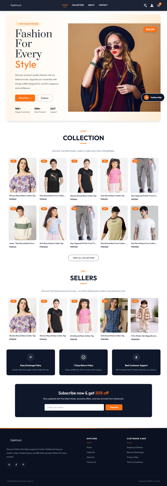
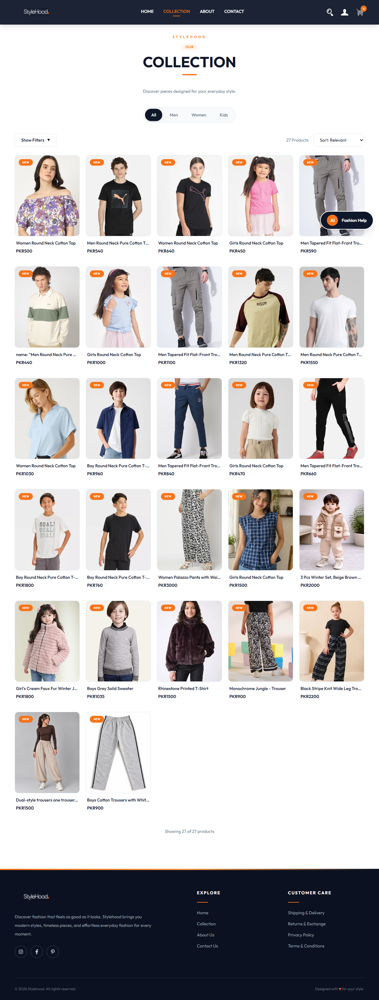
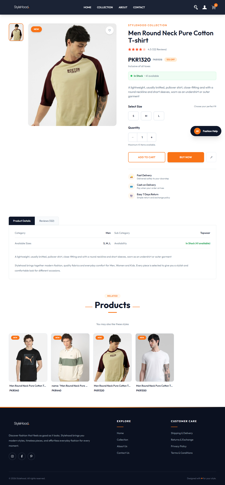
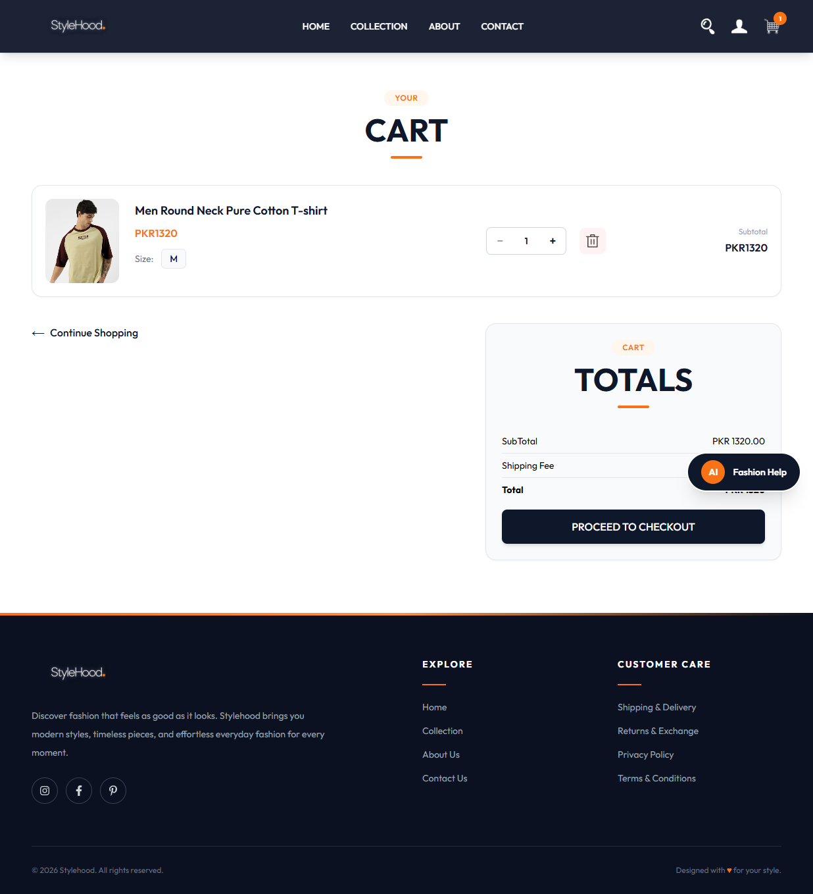
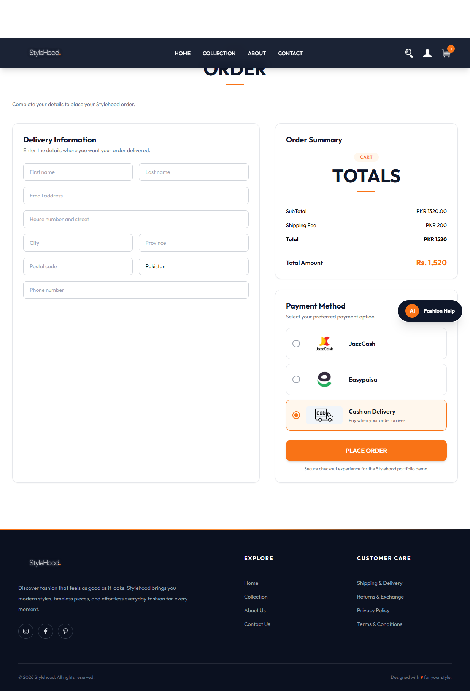
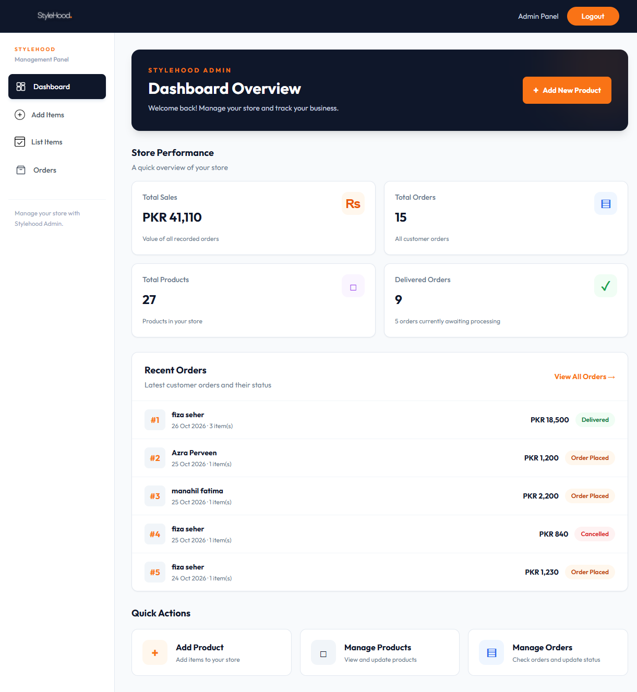

# Stylehood — MERN Stack E-commerce

Stylehood is a full-stack clothing e-commerce website built with the MERN stack, featuring fashion collections for men, women, and kids.

## 🌐 Live Website

[Visit Stylehood](https://stylehood-ecommerce.vercel.app)

## ✨ Features

- Modern, responsive clothing store UI
- Men’s, women’s, and kids’ collections
- Product browsing and search
- Product details and size selection
- Shopping cart and quantity management
- User registration and login
- Order placement and order history
- Order status tracking
- Admin dashboard for product and order management
- Product image uploads
- Cash on Delivery (COD) checkout

## 🛠️ Tech Stack

**Frontend:** React, Vite, Tailwind CSS

**Backend:** Node.js, Express.js

**Database:** MongoDB

**Authentication:** JSON Web Tokens (JWT)

**Other Tools:** Git, GitHub, Cloudinary

## 📁 Project Structure

- `frontend/` — Customer-facing website
- `backend/` — API, authentication, database and order management
- `admin/` — Admin dashboard

## ⚙️ Local Setup

1. Clone this repository.
2. Install dependencies in the `frontend`, `backend`, and `admin` directories.
3. Configure the required environment variables using your own credentials.
4. Start the backend server.
5. Start the frontend and admin development servers.

Never commit `.env` files or private API credentials.

## 👩‍💻 Developer

Built as a full-stack MERN e-commerce portfolio project.

## 📸 Website Screenshots

### 🏠 Home Page

### 🛍️ Collection Page

### 👗 Product Details

### 🛒 Shopping Cart

### 💳 Checkout / Place Order Page

### 🖥️ Admin Dashboard
